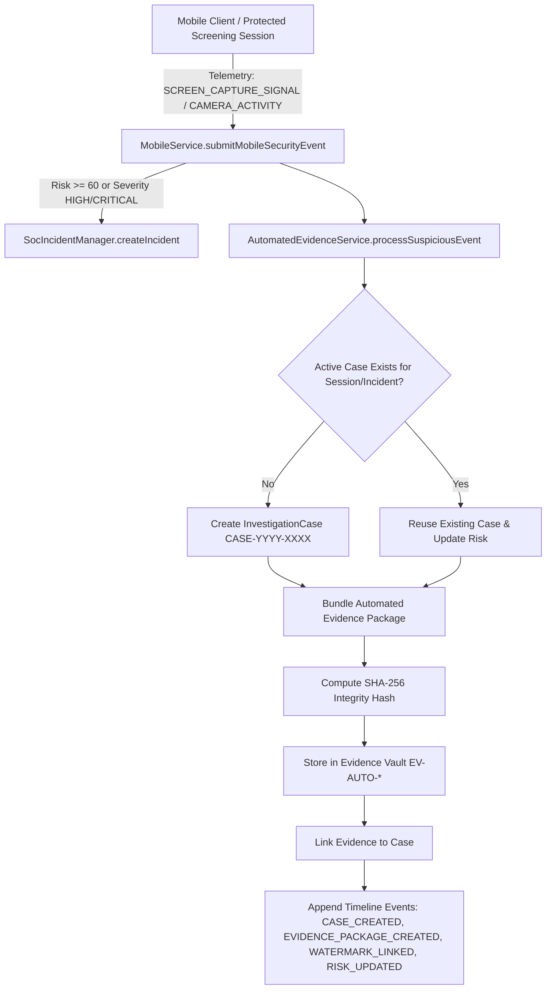

# Real-Time Evidence Capture & Investigation Automation Architecture

## Overview — Phase 26

Phase 26 automates the critical bridge between **Mobile Security Telemetry**, **Unified SOC Incidents**, **Evidence Vault Records**, and **Investigation Case Dossiers**. When suspicious mobile signals (such as screen recording attempts, camera state changes, or application switching) occur during an active screening session, the platform automatically correlates the events, bundles an immutable evidence package with cryptographic SHA-256 integrity verification, and maintains continuous case timeline tracking.

---

## 1. Automated Correlation & Evidence Pipeline



---

## 2. Automated Evidence Package Composition

The `AutomatedEvidenceService` packages the following parameters into a canonical JSON payload:

```json
{
  "packageId": "PKG-1724962800000-842",
  "incidentReference": {
    "id": "incident-uuid",
    "incidentNumber": "INC-2026-0042",
    "title": "Mobile Anomaly Signal: SCREEN_CAPTURE_SIGNAL",
    "severity": "HIGH",
    "riskScore": 80
  },
  "screeningSession": {
    "sessionId": "SES-MOB-CYB-35505-0001",
    "activationId": "activation-uuid",
    "seatNumber": "K-12",
    "ticketNumber": "TCK-P26-35505"
  },
  "theatre": {
    "id": "theatre-uuid",
    "name": "Cyberia Star Multiplex",
    "code": "CYB-35505"
  },
  "movie": {
    "id": "movie-uuid",
    "title": "Neural Overdrive"
  },
  "screen": {
    "name": "Screen 1 IMAX Laser"
  },
  "securityEventTimeline": [
    {
      "eventType": "SCREEN_CAPTURE_SIGNAL",
      "timestamp": "2026-08-29T17:11:40.000Z",
      "severity": "HIGH",
      "eventId": "EVT-MOB-1724962800-abc"
    }
  ],
  "watermarkReference": {
    "watermarkId": "WM-CYB-35505.SES-MOB-CYB-35505-0001.57498.a1b2c3d4",
    "displayString": "CYB-35505 • SES-MOB-CYB-35505-0001 • 57498 • a1b2c3d4",
    "timeSlot": 57498
  },
  "riskScore": 80,
  "severity": "HIGH",
  "generatedAt": "2026-08-29T17:11:40.000Z"
}
```

---

## 3. Cryptographic Verification & Integrity Assurance

1. **SHA-256 Hashing**: The canonical JSON string of the package is hashed via `evidenceHashService.computeSha256(canonicalPayload)`.
2. **Deterministic Verification**: When an analyst clicks **"Verify SHA-256 Integrity"** in the frontend or triggers `POST /api/investigations/:id/verify-integrity`, the system extracts every linked `EvidenceRecord`, recomputes the SHA-256 digest from `metadata`, and verifies it against the immutable hash in the record.

---

## 4. Safety, Privacy & Multi-Tenant Boundaries

- **Approval-First Workflow**: Automated evidence capture never automatically cancels tickets, bans user accounts, or halts playback. Containment actions remain approval-first.
- **Tenant Isolation**: Cross-theatre access to cases or evidence bundles is strictly forbidden (`403 UNAUTHORIZED_THEATRE`).
- **Zero Sensitive Data**: Evidence packages omit passwords, JWT tokens, credit card numbers, and raw biometrics.
