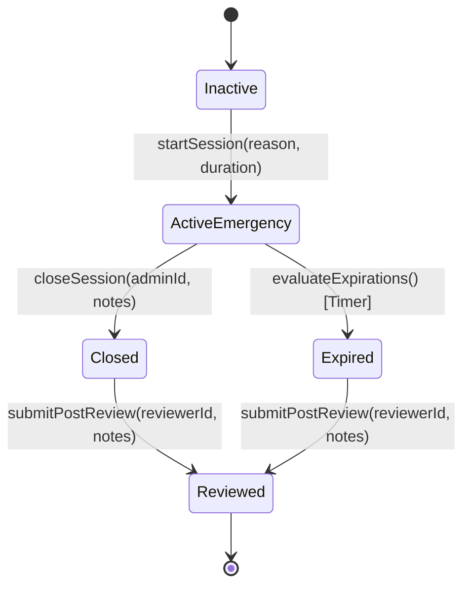

# Break-Glass Emergency Operations Protocol

## 1. Purpose & Guiding Principles

Break-Glass access provides authorized security administrators with time-bounded, elevated operational authority during disaster recovery, live cyber incidents, or network partitioning events.

### Invariant Rules:
1. **Never Silently Bypass Auditing**: Break-glass operations emit high-priority audit events and real-time SOC alerts.
2. **Mandatory Justification**: Activation requires a minimum 10-character explanation of emergency necessity.
3. **Hard Time Limits**: Sessions expire automatically after a maximum of 120 minutes (default 60 minutes).
4. **Mandatory Post-Incident Review**: Sessions must be formally audited and signed off by a compliance officer.

---

## 2. Break-Glass Lifecycle & Workflow

---

## 3. Real-Time Telemetry & Alerting

Upon activation of any Break-Glass session:
- A canonical identifier (`BG-YYYY-XXXX`) is assigned.
- A `BREAK_GLASS_EMERGENCY_ACTIVE` event is broadcast across the real-time event bus (`realtimeEventBus`).
- A `CRITICAL` severity event is appended to `GovernanceAuditEvent`.
- The Command Center and Enterprise Dashboard render persistent pulsing emergency banners.
