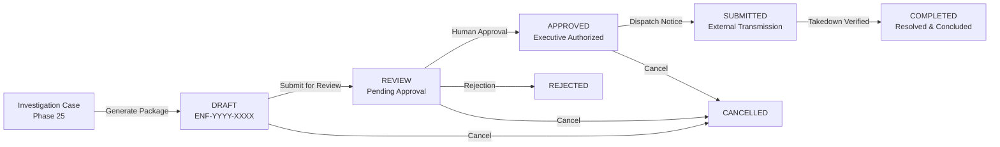

# Phase 27 — Piracy Response & Enforcement Workflow

## 1. Executive Overview

The **Piracy Response & Enforcement** system extends the Theatre Anti-Piracy Platform by providing an end-to-end, evidence-backed enforcement workflow on top of the Phase 25 investigation and case-management infrastructure.

The workflow enables authorized security analysts, studio representatives, and legal compliance officers to transition forensic evidence into formal enforcement responses (DMCA takedowns, cease-and-desist notices, ISP/cyberlock abuse filings, platform copyright claims, and auditorium device/seat blacklists) with cryptographic tamper-evidence, strict multi-tenant isolation, automated secret/PII redaction, and mandatory human approval safeguards.



---

## 2. Core Architecture & Services

The enforcement subsystem is structured under `api/src/services/enforcement/`:

### 2.1 `EnforcementService` (`enforcementService.ts`)
- **Action Orchestration**: Manages the creation, progression, state machine validation, and resolution of enforcement actions.
- **Canonical Naming**: Issues sequential identifiers in `ENF-YYYY-XXXX` format.
- **Case Eligibility Check**: Validates that target investigation cases exist and are active (rejects cases in `CLOSED` or `ARCHIVED` status).
- **Duplicate Prevention**: Prevents concurrent duplicate active enforcement actions of the same type for a single case.
- **Multi-Tenant Isolation**: Enforces cross-theatre and cross-studio boundary checks for both read and write operations.

### 2.2 `EnforcementEvidenceService` (`enforcementEvidenceService.ts`)
- **Package Compilation**: Assembles forensic evidence records, watermark attributions, screening session telemetry, auditorium details, and timeline logs into a self-contained bundle.
- **Integrity Calculation**: Computes deterministic SHA-256 hashes across canonical JSON package representations.
- **Zero-Secret Redaction**: Recursively strips and masks password hashes, JWTs, bearer tokens, credit card numbers, and session keys.
- **Forensic Verification**: Validates the cryptographic hashes of all attached evidence vault items.

### 2.3 `EnforcementApprovalService` (`enforcementApprovalService.ts`)
- **Mandatory Human Approval Policy**: Strictly blocks automatic punitive or legal actions; requires human review by authorized roles (`ADMIN`, `THEATRE_ADMIN`, or Studio Officers).
- **Integrity Safeguards**: Validates evidence package hashes prior to granting approval.
- **Decision Audit Trail**: Ingests approval/rejection events into `SecurityAuditLog` and updates case timeline records.

---

## 3. Enforcement Lifecycle State Machine

Enforcement actions strictly adhere to the following transition rules:

| Current Status | Allowed Transitions | Permitted Roles | Notes |
|---|---|---|---|
| **DRAFT** | `REVIEW`, `CANCELLED` | `ADMIN`, `THEATRE_ADMIN`, `THEATRE_STAFF`, `PRODUCTION_COMPANY` | Evidence package compiled; analyst drafting. |
| **REVIEW** | `APPROVED`, `REJECTED`, `DRAFT`, `CANCELLED` | `ADMIN`, `THEATRE_ADMIN`, `PRODUCTION_COMPANY` | Under compliance/legal evaluation. Regular staff cannot approve. |
| **APPROVED** | `SUBMITTED`, `CANCELLED` | `ADMIN`, `THEATRE_ADMIN`, `PRODUCTION_COMPANY` | Executive authorization granted; ready for transmission. |
| **SUBMITTED** | `COMPLETED`, `REJECTED`, `CANCELLED` | `ADMIN`, `THEATRE_ADMIN`, `PRODUCTION_COMPANY` | Dispatched to external ISP, CDN abuse desk, or host. |
| **COMPLETED** | *None (Terminal)* | — | Takedown verified and leak mitigated. |
| **REJECTED** | `DRAFT`, `REVIEW`, `CANCELLED` | `ADMIN`, `THEATRE_ADMIN`, `PRODUCTION_COMPANY` | Requires mandatory rejection reason. |
| **CANCELLED** | *None (Terminal)* | — | Action aborted by authorized operator. |

---

## 4. Evidence Package Data Contract

```typescript
interface EnforcementPackageData {
  packageId: string;                     // e.g. "ENF-PKG-1725000000-1024"
  generatedAt: string;                   // ISO 8601 Timestamp
  generatedBy: { id: string; email: string; role: string };
  caseReference: {
    id: string;
    caseNumber: string;                  // e.g. "CASE-2026-0042"
    title: string;
    severity: "LOW" | "MEDIUM" | "HIGH" | "CRITICAL";
    threatClassification?: string;
    status: string;
    openedAt: string;
  };
  incidentReference?: {
    id: string;
    incidentNumber: string;              // e.g. "INC-2026-0089"
    title: string;
    severity: string;
    riskScore: number;
  };
  screeningSession?: {
    sessionId: string;
    activationId?: string;
    ticketNumber?: string;
    seatNumber?: string;
    screenName?: string;
    showStartTime?: string;
  };
  theatre?: { id: string; name: string; code: string; location: string };
  movie?: { id: string; title: string; language?: string; durationMinutes?: number };
  watermarkAttribution?: {
    watermarkId: string;
    displayString?: string;
    timeSlot?: number;
    theatreCode?: string;
    seatNumber?: string;
    confidenceScore: number;             // e.g. 98%
  };
  evidenceRecords: Array<{
    evidenceId: string;
    evidenceNumber: string;              // e.g. "EV-AUTO-009182"
    classification: string;
    severity: string;
    status: string;
    source: string;
    integrityHash: string;               // SHA-256
    isIntegrityVerified: boolean;
    artifactCount: number;
    capturedAt: string;
  }>;
  timeline: Array<{
    timestamp: string;
    eventType: string;
    title: string;
    description: string;
  }>;
  packageIntegrityHash: string;          // Cryptographic SHA-256 over canonical package
  isFullyVerified: boolean;
  complianceNotice: string;
}
```

---

## 5. Security & Multi-Tenant Rules

1. **Zero-Secret Guarantee**:
   - `passwordHash`, `sessionToken`, `jwt`, `apiKey`, `authorization`, `creditCard`, `cvv`, and private key fields are scrubbed and replaced with `[REDACTED]`.
2. **Multi-Tenant Isolation**:
   - `THEATRE_STAFF` can only view and create enforcement actions corresponding to their assigned `theatreId`.
   - Attempts by staff to access or act on foreign venue cases are denied with `403 UNAUTHORIZED_THEATRE`.
3. **Immutable Audit Events**:
   - Every creation, status transition, review, approval, submission, and completion writes an immutable record to both the investigation case timeline and `SecurityAuditLog`.
   - Every action preserves end-to-end `correlationId` tracking.

---

## 6. REST API Reference

All endpoints are mounted under `/api/enforcement` and require a valid Bearer JWT:

| Method | Endpoint | Description | Allowed Roles |
|---|---|---|---|
| `POST` | `/api/enforcement` | Create enforcement action from case | `ADMIN`, `THEATRE_ADMIN`, `THEATRE_STAFF`, `PRODUCTION_COMPANY` |
| `GET` | `/api/enforcement` | List enforcement queue (scoped) | `ADMIN`, `THEATRE_ADMIN`, `THEATRE_STAFF`, `PRODUCTION_COMPANY` |
| `GET` | `/api/enforcement/:id` | Get enforcement details & timeline | `ADMIN`, `THEATRE_ADMIN`, `THEATRE_STAFF`, `PRODUCTION_COMPANY` |
| `GET` | `/api/enforcement/:id/package` | Retrieve/generate evidence package | `ADMIN`, `THEATRE_ADMIN`, `THEATRE_STAFF`, `PRODUCTION_COMPANY` |
| `POST` | `/api/enforcement/:id/review` | Submit action for human review | `ADMIN`, `THEATRE_ADMIN`, `THEATRE_STAFF`, `PRODUCTION_COMPANY` |
| `POST` | `/api/enforcement/:id/approve` | Approve enforcement action | `ADMIN`, `THEATRE_ADMIN`, `PRODUCTION_COMPANY` |
| `POST` | `/api/enforcement/:id/reject` | Reject action with mandatory reason | `ADMIN`, `THEATRE_ADMIN`, `PRODUCTION_COMPANY` |
| `POST` | `/api/enforcement/:id/submit` | Transmit package to target entity | `ADMIN`, `THEATRE_ADMIN`, `PRODUCTION_COMPANY` |
| `POST` | `/api/enforcement/:id/complete` | Mark action successfully completed | `ADMIN`, `THEATRE_ADMIN`, `PRODUCTION_COMPANY` |
| `POST` | `/api/enforcement/:id/cancel` | Cancel enforcement action | `ADMIN`, `THEATRE_ADMIN`, `THEATRE_STAFF`, `PRODUCTION_COMPANY` |
| `GET` | `/api/enforcement/:id/verify` | Verify SHA-256 package integrity | `ADMIN`, `THEATRE_ADMIN`, `THEATRE_STAFF`, `PRODUCTION_COMPANY` |
