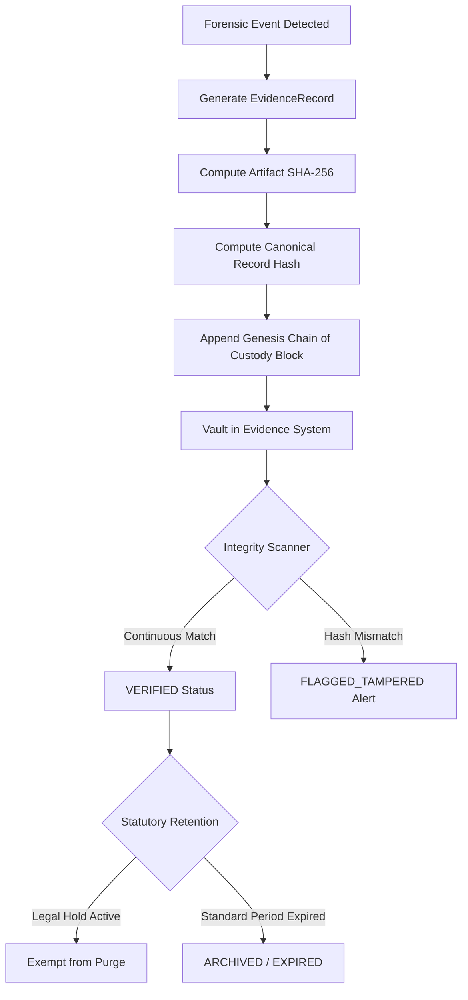

# Forensic Evidence Management Architecture

## 1. Overview

The **Evidence Management System** in Phase 17 provides a cryptographically verifiable, zero-PII forensic evidence vault for the Theatre Anti-Piracy Platform. Every acquired artifact (dynamic watermarking frames, sensor triggers, anomalous playback captures, DRM tampering events) is sealed with a SHA-256 integrity hash and tracked within an immutable cryptographic chain of custody.

```text
┌────────────────────────┐      ┌────────────────────────┐      ┌────────────────────────┐
│  Forensic Acquisition  │ ───> │  Canonical Record Hash │ ───> │  SHA-256 Chain Block   │
│  (Sensor/Watermark)    │      │  (JSON Canonical Form) │      │  (Genesis -> Linked)   │
└────────────────────────┘      └────────────────────────┘      └────────────────────────┘
                                             │
                                             ▼
                                ┌────────────────────────┐
                                │ Evidence Record Vault  │
                                │ (Legal Hold Protected) │
                                └────────────────────────┘
```

---

## 2. Core Data Models

### `EvidenceRecord`
* **Identifier**: `evidenceNumber` (format: `EV-XXXXXX`)
* **Classification**: `WATERMARK_MATCH`, `SCREEN_RECORDING_CAPTURE`, `SESSION_ANOMALY`, `DRM_TAMPER_LOG`, `UNAUTHORIZED_FEED`, `SPECTRAL_LEAK_ANALYSIS`, `PHYSICAL_SENSOR_TRIGGER`.
* **Severity**: `CRITICAL`, `HIGH`, `MEDIUM`, `LOW`, `INFO`.
* **Status**: `COLLECTED`, `VERIFIED`, `FLAGGED_TAMPERED`, `UNDER_REVIEW`, `ARCHIVED`, `LEGAL_HOLD`.
* **Retention Status**: `ACTIVE`, `EXPIRED`, `ARCHIVED`, `LEGAL_HOLD`, `PURGED`.
* **Cryptographic Seal**: `integrityHash` (SHA-256 of canonical metadata and screening context).

### `EvidenceArtifact`
* **Artifact Properties**: `artifactName`, `artifactType`, `mimeType`, `fileSizeBytes`.
* **Integrity Proof**: `sha256Hash` calculated over raw artifact binary/payload.
* **Storage**: In-database payload snippet or secure non-volatile storage path.

---

## 3. Evidence Lifecycle



---

## 4. Privacy & Zero-Secret Guarantee

* **No Master Keys**: DRM decryption keys and JWT secrets are strictly prohibited from evidence records.
* **Zero PII**: Payloads reference screening session hashes, auditorium seats, and screen identifiers rather than patron personal identifiable information.
* **Timing-Safe Verification**: Hash comparison executes using `crypto.timingSafeEqual` to prevent side-channel timing attacks.
