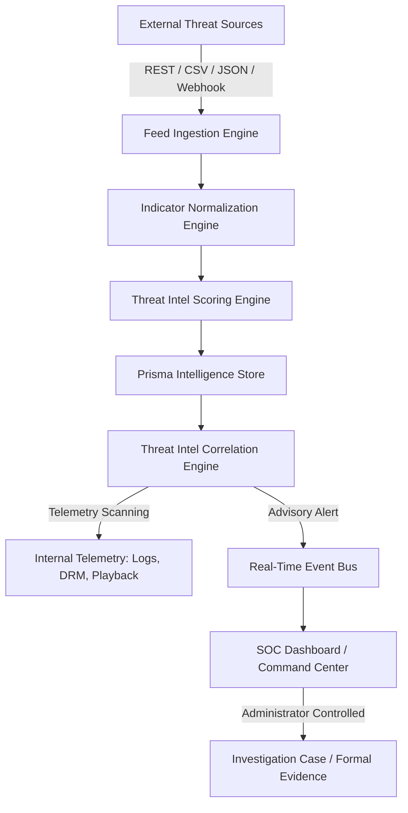

# External Threat & Industry Anti-Piracy Intelligence Architecture (Phase 18)

## 1. Executive Summary & Objective

The External Threat Intelligence platform (Phase 18) connects the Theatre Anti-Piracy Platform with industry-wide threat intelligence sources, film studio piracy alliances, commercial threat feeds, and trusted ISAC (Information Sharing and Analysis Center) data exchanges.

It enables automated ingestion, canonical normalization, deterministic confidence scoring, internal telemetry correlation, and piracy campaign dossiers without violating security boundaries or disrupting legitimate screenings.

---

## 2. Architectural Principles & Safety Core

### Safety & Non-Disruption Guarantees
1. **Advisory-First Principle**: External intelligence indicators are inherently third-party signals. An external indicator match alone **NEVER** terminates playback, revokes active tickets, revokes DRM licenses, or blocks theatres.
2. **Zero-Secret Storage**: Plaintext provider API keys and authorization tokens are never returned in UI or API queries.
3. **Cryptographic Webhook Integrity**: Inbound feeds require HMAC-SHA256 signatures with 300-second timestamp freshness windows and replay protection.
4. **Legal Hold Immunity**: Indicators associated with active legal proceedings or investigations cannot be aged out or deleted.

---

## 3. Database Schema Overview

| Model | Description |
| :--- | :--- |
| `ThreatIntelSource` | Registered feed provider with trust level (0–100) and sync metadata. |
| `ThreatIntelFeed` | Individual subscription feed under a source. |
| `ThreatIntelIndicator` | Canonical IOC (IP, Domain, URL, Hash, Email, Fingerprint) with deterministic confidence. |
| `ThreatIntelObservation` | Sightings telemetry from external feeds and internal sensors. |
| `ThreatIntelRelationship` | Graph relations linking indicators to campaigns, actors, and targets. |
| `ThreatIntelCampaign` | Coordinated piracy syndication dossier (`CMP-YYYY-XXXX`). |
| `ThreatIntelMatch` | Non-destructive correlation hit linking IOCs to screening telemetry. |
| `ThreatIntelSourceHealth`| Latency and response metrics for source reliability. |
| `ThreatIntelImport` | Audit log for manual and scheduled feed ingestion batches. |
| `ThreatIntelAction` | Administrator-approved response actions. |

---

## 4. API Endpoints (`/api/threat-intelligence`)

- `GET /stats`: Aggregated KPI counters and confidence distribution.
- `GET /sources`: List registered threat sources (with secret masking).
- `POST /sources`: Register a new threat intelligence source.
- `POST /sources/:id/sync`: Trigger manual feed pull and internal correlation.
- `GET /source-health`: Provider uptime and latency health status.
- `GET /indicators`: Search and filter normalized IOC indicators.
- `GET /indicators/:id`: Detailed indicator profile with observations and matches.
- `POST /indicators/:id/validate`: Analyst confirmation or false-positive marking.
- `GET /matches`: Internal telemetry correlation matches.
- `GET /campaigns`: List coordinated piracy campaigns.
- `POST /campaigns`: Create a campaign dossier.
- `POST /feeds/import`: Ingest CSV/JSON threat feeds.
- `POST /webhook/:sourceId`: Inbound webhook endpoint with HMAC verification.
- `POST /analyze`: Safe pre-flight indicator normalization and scoring test.
