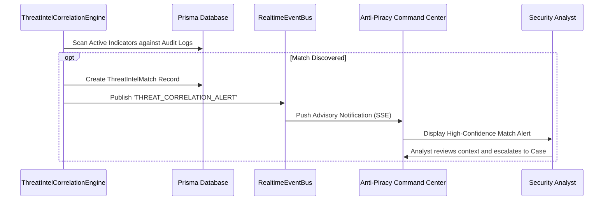

# Internal Telemetry Correlation Engine & Advisory Matching

## 1. Automated Correlation Architecture

The `ThreatIntelCorrelationEngine` continuously or on-demand cross-references external threat indicators against historical and live internal platform events:

| External IOC Type | Internal Telemetry Surface | Correlation Type |
| :--- | :--- | :--- |
| `IP_ADDRESS` | `SecurityAuditLog.ipAddress` | `IP_AUDIT_MATCH` |
| `IP_ADDRESS` | `PlaybackSession.ipAddress` | `IP_PLAYBACK_MATCH` |
| `FILE_HASH` | `EvidenceArtifact.sha256Hash` | `EVIDENCE_HASH_MATCH` |
| `DEVICE_FINGERPRINT` | `SecurityAuditLog.deviceFingerprint` | `DEVICE_FINGERPRINT_MATCH` |

---

## 2. Advisory Correlation Workflow

---

## 3. Match Records & Telemetry Context

When a correlation is identified, a `ThreatIntelMatch` is generated containing:
- `indicatorId`: Link to canonical indicator.
- `correlationType`: Category of match (e.g. `IP_AUDIT_MATCH`).
- `confidence`: Matched indicator confidence score.
- `theatreId`, `movieId`, `playbackSessionId`: Target cinema context.
- `correlationDetails`: Human-readable summary for analyst inspection.
