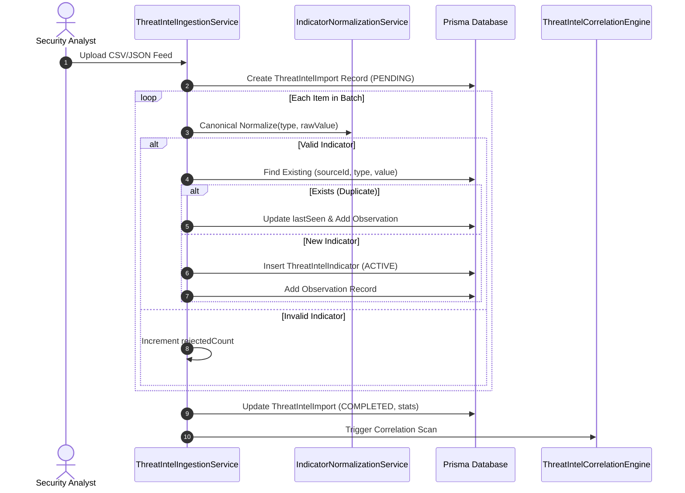

# Threat Intelligence Feed Operations & Ingestion

## 1. Supported Ingestion Formats

The platform ingests external intelligence via multiple channels:
1. **REST Pull**: Scheduled polling of authenticated JSON endpoints.
2. **Batch CSV / JSON Upload**: Manual analyst bulk imports with pre-validation.
3. **Real-time Webhook Push**: Inbound push notifications secured via HMAC-SHA256.

---

## 2. Ingestion Pipeline & Deduplication



---

## 3. CSV Format Specification

Feed files uploaded in CSV format must contain the following standard headers:

```csv
type,value,threatClassification,description
IP_ADDRESS,198.51.100.45,CAM_DISTRIBUTOR,Known restreaming proxy IP
DOMAIN,cam-ripper-network.cc,LEAK_PORTAL,Cam torrent distribution index
URL,https://streams.pirate.org/live/cam.m3u8,LIVE_STREAM,Active theatrical restream URL
FILE_HASH,e3b0c44298fc1c149afbf4c8996fb92427ae41e4649b934ca495991b7852b855,CAM_FILE,SHA-256 hash of leaked screener
```

---

## 4. Feed Health & Latency Tracking

Every feed provider tracks:
- **Response Latency**: Measured in milliseconds.
- **HTTP Response Codes**: 200, 401, 429, 500 status classification.
- **Records Ingested vs Rejected**: Quality metrics for feed reliability.
- **Health Transitions**: `HEALTHY` -> `DEGRADED` (latency > 2000ms or rejected > 20%) -> `UNHEALTHY` (errors or timeout).
