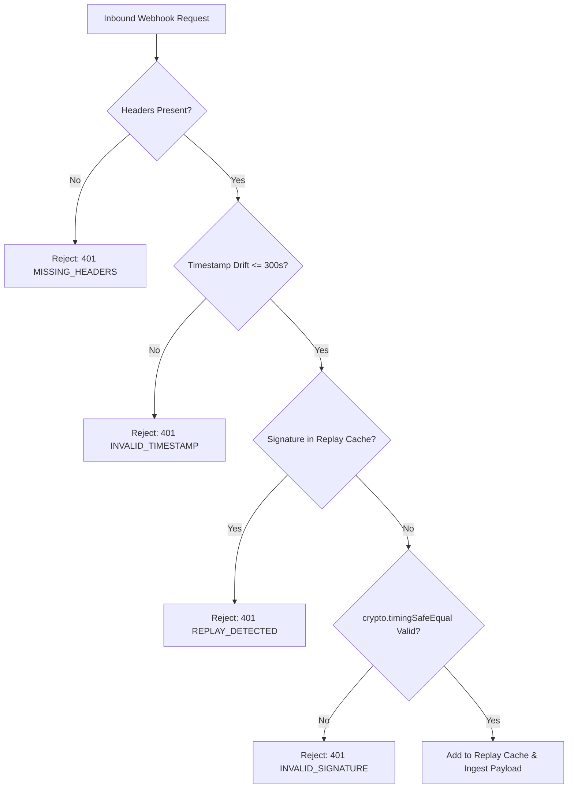

# Threat Intelligence Webhook Security Specification

## 1. Cryptographic HMAC-SHA256 Verification

Inbound push feeds via `/api/threat-intelligence/webhook/:sourceId` require signed HTTP requests to prevent tampering and spoofing.

### Required HTTP Headers:
- `X-Threat-Signature`: Hex-encoded HMAC-SHA256 digest of `${timestamp}.${rawPayload}` signed with the configured source webhook secret.
- `X-Threat-Timestamp`: Unix timestamp (seconds) when the payload was generated.

---

## 2. Replay Protection & Drift Validation

### Security Controls:
1. **Timestamp Freshness**: Requests with timestamps drifting more than $\pm 300\text{ seconds}$ from system time are immediately rejected.
2. **Replay Cache**: Processed signatures are cached in memory for 10 minutes; duplicate signatures are dropped.
3. **Timing-Safe Comparison**: Signature buffers are compared using constant-time `crypto.timingSafeEqual()` to mitigate side-channel timing attacks.
4. **Security Audit Logging**: Every signature rejection logs a `SUSPICIOUS_ACTIVITY` audit event with the caller IP.
