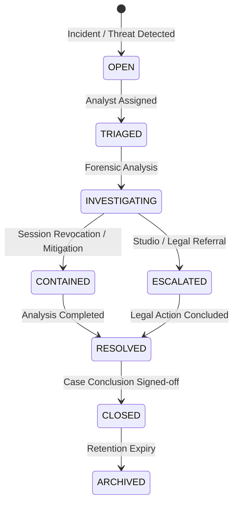

# Anti-Piracy Investigation Case Management

## 1. Overview

The **Investigation Case Management** system enables anti-piracy analysts, studio security teams, and cinema operations staff to coordinate incident triaging, forensic evidence analysis, and mitigation workflows.

---

## 2. Case Lifecycle States



### State Definitions
1. **`OPEN`**: Unassigned incident created from real-time alert or forensic watermarking detection.
2. **`TRIAGED`**: Assigned to an anti-piracy investigator with initial priority set.
3. **`INVESTIGATING`**: Active examination of forensic telemetry, spectral watermarks, and seat records.
4. **`CONTAINED`**: Piracy vector neutralized (playback session terminated, token revoked).
5. **`ESCALATED`**: Transferred to senior studio counsel or law enforcement.
6. **`RESOLVED`**: Technical and investigative steps concluded.
7. **`CLOSED`**: Formal case sign-off with closure timestamp and rationale.
8. **`ARCHIVED`**: Preserved in cold storage for compliance retention.

---

## 3. Case Structure & Relations

```text
┌─────────────────────────────────────────────────────────────┐
│                 InvestigationCase (CASE-XXXX)                │
├─────────────────────────────────────────────────────────────┤
│ ├── InvestigationAssignment (Lead & Contributing Analysts)  │
│ ├── InvestigationNote (Internal & External Observations)    │
│ ├── InvestigationEvidenceLink (Linked EvidenceRecords)      │
│ ├── InvestigationTimelineEvent (Chronological Activity)     │
│ └── InvestigationStatusHistory (State Transition Audit)     │
└─────────────────────────────────────────────────────────────┘
```

---

## 4. RBAC & Multi-Tenant Isolation

* **`ADMIN`**: Global visibility across all cinema venues, studio cases, and evidence records.
* **`PRODUCTION_COMPANY`**: Scoped strictly to cases involving movies owned by the authenticated production studio.
* **`THEATRE_STAFF`**: Scoped strictly to physical auditorium incidents within their assigned cinema venue.
