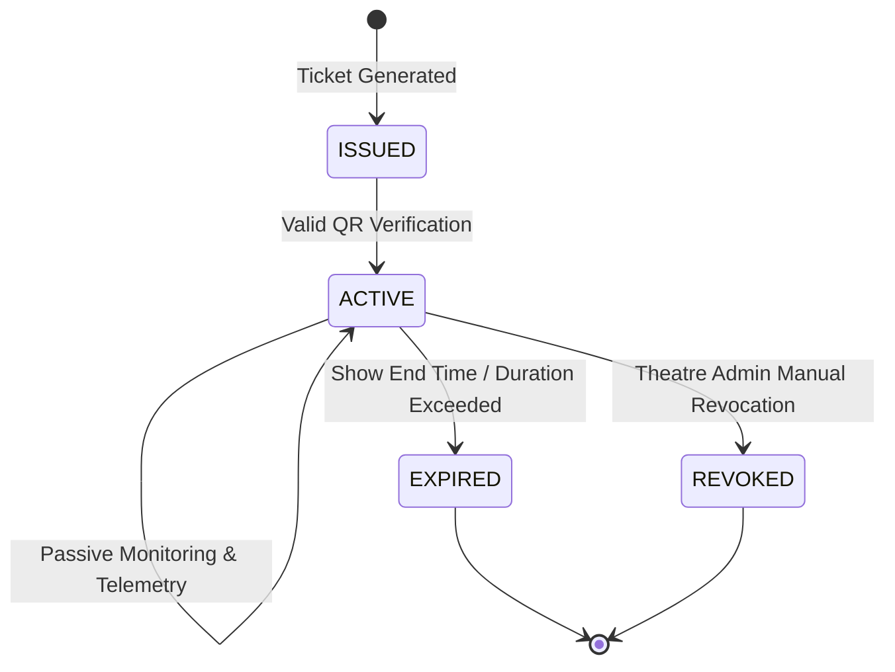

# Mobile Anti-Piracy Protection & SOC Detection (Phase 23)

## 1. Architectural Overview

The Phase 23 Mobile Anti-Piracy Protection layer establishes a continuous, passive security telemetry loop between active mobile screening sessions and the central Security Operations Center (SOC):

```
┌─────────────────┐       ┌────────────────────────┐       ┌────────────────────────┐
│  Ticket QR Code │ ───>  │ Active Screening       │ ───>  │ Passive Security       │
│  Verification   │       │ Session (SES-MOB-...)  │       │ Monitoring Service     │
└─────────────────┘       └────────────────────────┘       └────────────────────────┘
                                                                       │
                                                                       ▼
┌─────────────────┐       ┌────────────────────────┐       ┌────────────────────────┐
│ SOC Incident    │ <───  │ Mobile Security API    │ <───  │ Normalized Signals     │
│ Correlation     │       │ POST /api/mobile/events│       │ (Capture, Blur, Cam)   │
└─────────────────┘       └────────────────────────┘       └────────────────────────┘
```

---

## 2. Supported Browser & Device Capabilities (Platform Limitations)

In accordance with web security sandboxing standards, a browser-based web application cannot forcibly take over or disable physical device hardware (such as phone lenses or operating system background processes).

### What the Platform Monitored:
1. **Screen Visibility Changes**: Detects `document.visibilitychange` and `document.hidden` when the user minimizes the tab or switches to other apps during active playback.
2. **Window Focus Loss**: Detects `window.blur` when desktop/mobile overlays or capture software take focus.
3. **Fullscreen Exits**: Detects `fullscreenchange` events when protected playback mode is escaped.
4. **Keypress & Screen Recording Combinations**: Intercepts `PrintScreen`, `Ctrl+P`, `Cmd+Shift+3/4/5` and system capture keyboard triggers.
5. **Camera Permission / State Queries**: Monitors `navigator.permissions.query({ name: 'camera' })` status transitions.

### Platform Limitations (Safety & Transparency):
- Web applications cannot read hardware memory outside the browser sandbox.
- Web applications cannot guarantee 100% prevention of external analog optical recordings (e.g. pointing a second camera at the screen). Forensic session watermarking and dynamic QR auditing are used in conjunction to identify the origin of leaked content.

---

## 3. Normalized Security Event Types

| Event Type | Severity | Default Risk Delta | Trigger Mechanism |
|---|---|---|---|
| `SCREEN_CAPTURE_SIGNAL` | HIGH | +75 | PrintScreen, Ctrl+P, Mac recording hotkeys |
| `CAMERA_ACTIVITY` | HIGH | +65 | Camera hardware permission state transition |
| `FULLSCREEN_EXIT` | MEDIUM | +40 | Fullscreen viewing mode was exited |
| `SCREEN_VISIBILITY_CHANGE` | LOW / MEDIUM | +35 | Tab switch or background minimize |
| `SUSPICIOUS_ACTIVITY` | MEDIUM | +50 | Window focus lost to background task |
| `MOBILE_SECURITY_EVENT` | INFO / LOW | +25 | Standard telemetry heartbeat / audit ping |

---

## 4. Unified SOC Integration

Mobile security events sent to `/api/mobile/events` are ingested into three concurrent pipelines:
1. **`RealtimeThreatEvent`**: High-throughput time-series event ingestion with correlation IDs.
2. **`SecurityAuditLog`**: Permanent forensic audit ledger with user ID, actor email, IP address, and tenant context.
3. **`SocIncidentManager`**:
   - Anomalies with risk $\ge 60$ or severity $\ge \text{HIGH}$ automatically correlate with open security incidents or create a new incident in `DETECTED` state.
   - Workflows evaluate automated playbooks based on theatre risk thresholds.

---

## 5. Safety Guarantees & False-Positive Handling

To ensure high reliability and avoid disrupting legitimate patrons:
1. **No Automatic Session Termination**: Single weak signals (e.g. switching tabs or receiving an incoming phone call) **never** terminate or revoke the attendee's ticket or session.
2. **Non-Punitive User Guidance**:
   - Suspicious signals trigger a clear advisory banner:
     `"⚠️ Recording or photography is not permitted during this screening."`
   - Patrons can acknowledge the guidance and resume viewing without disruption.
3. **No Secret or PII Leakage**: Telemetry payloads strip all passwords, tokens, bearer keys, and unnecessary user PII before dispatching to the SOC.
4. **Debouncing & Rate Limiting**: Repeated noisy triggers are debounced (3.5s minimum window) to avoid flooding SOC streams.
5. **Tenant / Theatre Isolation**: Staff and operators can only inspect and correlate sessions belonging to their assigned theatre venue.

---

## 6. Session Lifecycle



- **Session Initialization**: Created with unique prefix `SES-MOB-<THEATRE_CODE>-<TIMESTAMP>-<RANDOM>`.
- **Live Countdown**: The client displays active session duration and automatically transitions status to `EXPIRED` once the screening window concludes.
