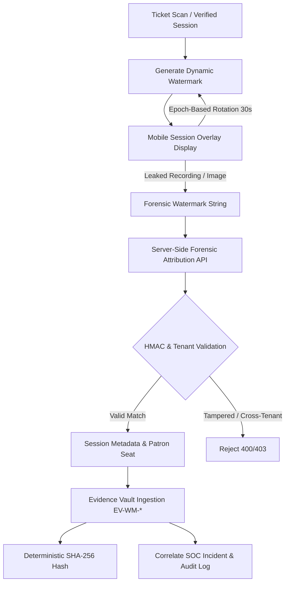

# Mobile Dynamic Session Watermarking & Forensic Evidence Architecture

## Overview — Phase 24

Phase 24 establishes a cryptographic dynamic session watermarking and forensic evidence tracking framework for the Theatre Anti-Piracy Platform. It extends the active patron screening session by embedding a time-rotating, session-bound watermark that enables complete session attribution, Evidence Vault recording, deterministic SHA-256 integrity hashing, and real-time SOC incident correlation without leaking user PII or system secrets.

---

## 1. Dynamic Watermarking Pipeline



### Watermark Identifier Composition

Watermark identifiers are cryptographically signed using server-side HMAC-SHA256:

$$\text{Watermark ID} = \text{WM-}\langle\text{theatreCode}\rangle.\langle\text{sessionId}\rangle.\langle\text{timeSlot}\rangle.\langle\text{HMAC}_{10}\rangle$$

Where:
- $\text{theatreCode}$: Canonical theatre identifier (e.g. `SOL-10492`).
- $\text{sessionId}$: Cryptographic screening session UUID.
- $\text{timeSlot}$: Epoch-based 30-second interval index ($\lfloor\text{epochSeconds} / 30\rfloor$).
- $\text{HMAC}_{10}$: First 10 hexadecimal characters of $\text{HMAC}_{\text{SHA-256}}(\text{sessionId}:\text{theatreCode}:\text{screenName}:\text{seatNumber}:\text{timeSlot}, \text{SECRET})$.

### Privacy & Zero-Trust Safety
- **No PII**: Names, emails, phone numbers, and payment details are never embedded in the watermark string.
- **No System Secrets**: Bearer tokens, passwords, database URIs, and JWTs are excluded from client watermarks.
- **Tenant Isolation**: Attribution lookups enforce multi-tenant isolation; operators from one theatre venue cannot inspect or attribute watermarks generated by another venue.

---

## 2. API Endpoints

| Method | Path | Auth Required | Description |
|---|---|---|---|
| `GET` | `/api/mobile/session/:sessionId/watermark` | Staff / Admin JWT | Returns dynamic rotating watermark for active session. |
| `POST` | `/api/mobile/watermark/attribute` | Staff / Admin JWT | Cryptographically attributes leaked watermark to originating session. |
| `POST` | `/api/mobile/watermark/evidence` | Staff / Admin JWT | Records forensic evidence in Evidence Vault with SHA-256 hash. |

---

## 3. Forensic Evidence Vault Integration

When a watermark is attributed during an investigation, an immutable `EvidenceRecord` is recorded:

```json
{
  "evidenceNumber": "EV-WM-1724949210-9428",
  "classification": "WATERMARK_MATCH",
  "severity": "HIGH",
  "status": "STORED",
  "retentionStatus": "ACTIVE",
  "integrityHash": "e3b0c44298fc1c149afbf4c8996fb92427ae41e4649b934ca495991b7852b855",
  "metadata": {
    "watermarkId": "WM-SOL-10492.SES-MOB-SOL-10492-7491.58800.C4F81E99D2",
    "sessionId": "SES-MOB-SOL-10492-7491",
    "ticketNumber": "TCK-WM-10492",
    "seatNumber": "K-09",
    "theatreName": "Solaris Multiplex",
    "screenName": "Screen 4 Laser IMAX",
    "movieTitle": "Interstellar Drift"
  }
}
```

---

## 4. Platform Limitations & Browser Sandbox Notice

1. **Client Watermark Overlay**: Dynamic visual watermarking on the mobile client serves as a deterrent and capture tracking mechanism.
2. **Browser Constraints**: A web-based client cannot prevent an external physical video camera or phone from filming the screen; forensic watermarking provides post-leak attribution rather than physical capture prevention.
3. **Passive Integrity**: Tampering with the client DOM or watermark parameters immediately invalidates the HMAC signature during server-side verification.
