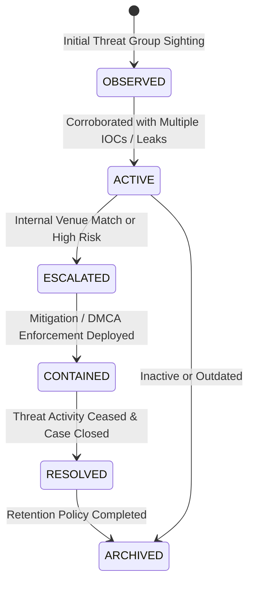

# Coordinated Piracy Campaign Management & Dossiers

## 1. Concept & Purpose

A **Piracy Campaign** groups disparate indicators of compromise, affected movies, targeted theatre venues, observed leak groups, and distribution channels into a single operational dossier.

Campaign identifiers use the canonical system format: `CMP-YYYY-XXXX` (e.g. `CMP-2026-0001`).

---

## 2. Campaign Lifecycle & State Machine

### Status Descriptions:
- **`OBSERVED`**: Emerging pattern or syndicate detected in external threat feeds.
- **`ACTIVE`**: Active campaign confirmed with live IOCs and targeted titles.
- **`ESCALATED`**: High-confidence correlation with internal platform telemetry or open investigation.
- **`CONTAINED`**: Legal, technical, or venue mitigation actions deployed.
- **`RESOLVED`**: All active links mitigated; formal incident closed.
- **`ARCHIVED`**: Preserved for historical analytics under compliance retention.

---

## 3. Integration with Investigation Cases (Phase 17)

When a campaign reaches `ESCALATED` status:
1. An analyst can link the campaign directly to an `InvestigationCase`.
2. Associated evidence records and watermark forensics are linked via `ThreatIntelRelationship`.
3. Chain-of-custody records log external intelligence correlations as context notes, preserving legal admissibility without confusing external rumors with cryptographic evidence.
