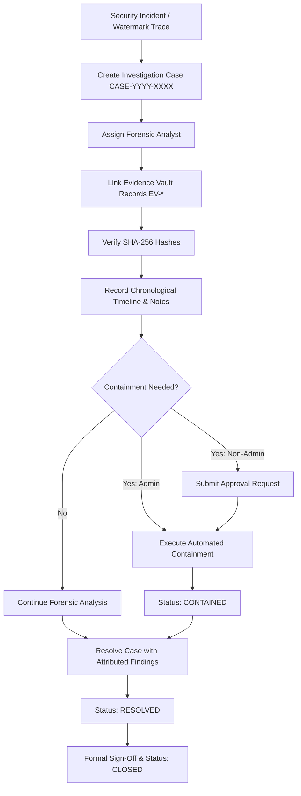

# Piracy Investigation & Case Management Architecture

## Overview — Phase 25

Phase 25 implements a comprehensive Piracy Investigation and Case Management system for the Theatre Anti-Piracy Platform. It connects security incidents, mobile anti-piracy telemetry, dynamic session watermarks, Evidence Vault records, and multi-tenant analyst operations into an immutable, verifiable forensic workflow.

---

## 1. Core Lifecycle & Workflow Pipeline

---

## 2. Canonical Case Identifier Format

Investigation cases adhere to the standardized format:

$$\text{Case Number} = \text{CASE-YYYY-XXXX}$$

Example: `CASE-2026-0001`
- `YYYY`: 4-digit calendar year.
- `XXXX`: 4-digit zero-padded sequential sequence counter.

---

## 3. Case State Machine Transitions

| From Status | Permitted Target Statuses | Rules / Role Constraints |
|---|---|---|
| `OPEN` | `TRIAGED`, `INVESTIGATING`, `CLOSED` | Initial creation state. Automatically transitions to `TRIAGED` when an analyst is assigned. |
| `TRIAGED` | `INVESTIGATING`, `CONTAINED`, `ESCALATED`, `RESOLVED`, `CLOSED` | Case scoped and assigned to lead investigator. |
| `INVESTIGATING` | `CONTAINED`, `ESCALATED`, `RESOLVED`, `CLOSED` | Forensic evidence collection and watermark extraction in progress. |
| `CONTAINED` | `RESOLVED`, `INVESTIGATING`, `CLOSED` | Active playback stream revoked or rogue device quarantined. |
| `ESCALATED` | `INVESTIGATING`, `CONTAINED`, `RESOLVED`, `CLOSED` | Elevated to global security engineering or legal teams. |
| `RESOLVED` | `CLOSED`, `INVESTIGATING` | Investigation concluded with documented resolution notes. |
| `CLOSED` | `ARCHIVED` | Terminal state with `closedAt` timestamp and closure reason recorded. |

---

## 4. Evidence Linking & Cryptographic Verification

When linking Evidence Vault items:
1. **Verification**: The system recalculates $\text{SHA-256}(\text{evidenceMetadata})$ and validates against `EvidenceRecord.integrityHash`.
2. **Duplicate Prevention**: Unique constraints ensure the same `EvidenceRecord` cannot be linked multiple times to the same case.
3. **Traceability**: Linkage actions generate append-only entries in `InvestigationTimelineEvent` tagged with correlation IDs.

---

## 5. Security, Multi-Tenancy & Privacy Controls

- **Theatre Scoping**: Theatre staff can only access and modify investigation cases associated with their `theatreId`. Cross-theatre access attempts are rejected with `403 UNAUTHORIZED_THEATRE`.
- **Approval-First Safety**: High-impact containment actions requested by non-admin staff require approval before stream termination or license revocation.
- **Zero Customer PII**: Case records store technical audit signals, seat numbers, and watermark identifiers without exposing customer credit cards, passwords, or personal biometric files.
