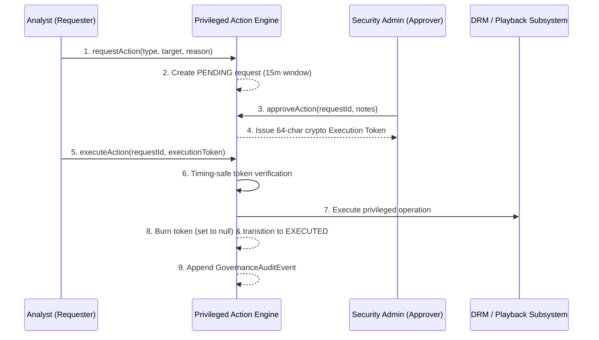

# Privileged Access Control & Two-Person Approval

## 1. Scope of Privileged Operations

The following operations are classified as **Privileged Actions** and cannot be executed unilaterally without two-person administrative authorization:
- `DRM_LICENSE_REVOKE`: Revoking active cryptographic playback licenses.
- `PLAYBACK_TERMINATE`: Force-terminating screening playback streams.
- `THEATRE_BLOCK`: Venue isolation or screen shutdown.
- `POLICY_MODIFY`: Production policy updates.
- `EVIDENCE_DELETE`: Deletion of forensic records.
- `BREAK_GLASS_ACTIVATE`: Emergency bypass activation.

---

## 2. Authorization Lifecycle

---

## 3. Cryptographic Token Safety & Expiration

- **Short-Lived Window**: Requests expire automatically after 15 minutes if not approved and executed.
- **Timing-Safe Comparison**: Execution tokens are verified using `crypto.timingSafeEqual` to prevent side-channel timing attacks.
- **Single-Use Burn**: The execution token is immediately deleted (`null`) upon successful execution, preventing token reuse.
