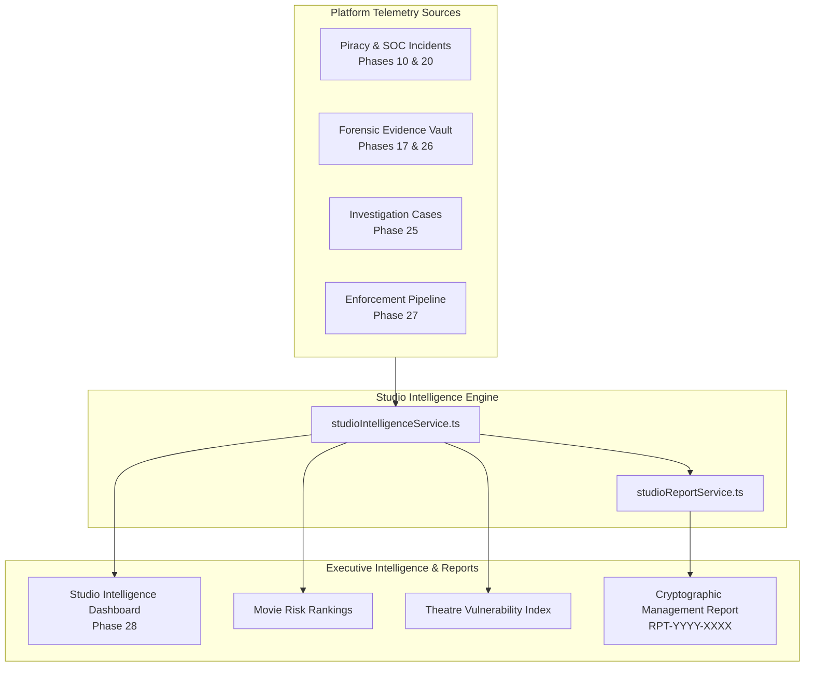

# Phase 28 — Studio Intelligence & Reporting

## 1. Executive Overview

The **Studio Intelligence & Executive Reporting** engine aggregates telemetry from across the Theatre Anti-Piracy Platform (Phases 20–27), transforming low-level security events, forensic watermark matches, investigation cases, and enforcement takedowns into actionable intelligence for film studios, content rights holders, and executive leadership.

---

## 2. Architecture & Subsystems

Located in `api/src/services/intelligence/`:

### 2.1 `StudioIntelligenceService` (`studioIntelligenceService.ts`)
- **Multi-Source Aggregation**: Reconciles `PiracyIncident`, `SecurityIncident`, `EvidenceRecord`, `InvestigationCase`, `Theatre`, `Movie`, and in-flight `EnforcementActionRecord` items into a unified real-time intelligence state.
- **Movie Threat Indexing**: Computes composite risk scores, critical leak counts, watermark matches, and active legal investigations for each film title in the studio's catalog.
- **Theatre Vulnerability Rating**: Analyzes venue leak frequency and device anomalies to classify theatre vulnerability (`LOW`, `MODERATE`, `ELEVATED`, `SEVERE`).
- **Pipeline Progression**: Summarizes investigation case funnels (`OPEN` → `TRIAGED` → `INVESTIGATING` → `CONTAINED` → `RESOLVED` → `CLOSED`) and enforcement lifecycle stages (`DRAFT` → `REVIEW` → `APPROVED` → `SUBMITTED` → `COMPLETED`).
- **Executive KPIs**: Computes global studio risk score (0–100), threat posture, high-risk incident ratio, forensic evidence count, and takedown success rate.

### 2.2 `StudioReportService` (`studioReportService.ts`)
- **Canonical Executive Reports**: Compiles standardized reports with sequential `RPT-YYYY-XXXX` identifiers.
- **Cryptographic Tamper-Evidence**: Generates a deterministic SHA-256 integrity hash over the canonical JSON representation of each report.
- **Multi-Format Export**: Supports direct JSON responses and formatted CSV exports.
- **Zero-Secret Certification**: Programmatically guarantees that password hashes, JWTs, bearer tokens, credit cards, and sensitive keys are stripped and redacted before rendering or export.

---

## 3. Executive KPI Definitions

| KPI Metric | Calculation Formula | Description |
|---|---|---|
| **Global Threat Posture** | Weighted average of incident risk scores (`0-19: NOMINAL`, `20-39: GUARDED`, `40-59: ELEVATED`, `60-79: HIGH`, `80-100: CRITICAL`) | Executive summary of studio catalog vulnerability. |
| **High Risk Ratio (%)** | `(High + Critical Incidents) / Total Incidents * 100` | Percentage of detected threats requiring immediate intervention. |
| **Takedown Success Rate (%)** | `Completed Enforcements / (Completed + Rejected + Cancelled) * 100` | Legal and platform enforcement efficacy percentage. |
| **Forensic Evidence Items** | Count of verified artifacts in `EvidenceRecord` vault | Cryptographically validated proof items available for legal hold. |
| **Watermark Attribution Hits** | Count of optical captures with confirmed seat/auditorium IDs | Direct physical leaks attributed to specific screenings. |

---

## 4. Multi-Tenant Studio & Theatre Isolation

1. **Studio / Production Company Scoping**:
   - `PRODUCTION_COMPANY` users are strictly isolated to movies, sessions, incidents, cases, and enforcements associated with their `productionCompanyId`.
   - Attempts to access unreleased titles or data belonging to another production house return filtered results with 0 records or `403 UNAUTHORIZED_STUDIO`.
2. **Theatre Scoping**:
   - `THEATRE_STAFF` / `THEATRE_ADMIN` users are restricted to telemetry from their assigned `theatreId`.
3. **Platform Administrator**:
   - `ADMIN` role retains global repertoire visibility across all studios, distributors, and exhibition chains.

---

## 5. REST API Reference

All routes require authentication with a valid Bearer JWT:

| Method | Endpoint | Description | Allowed Roles |
|---|---|---|---|
| `GET` | `/api/intelligence/studio/dashboard` | Aggregated studio dashboard telemetry, KPIs, and rankings | `ADMIN`, `PRODUCTION_COMPANY`, `THEATRE_ADMIN` |
| `GET` | `/api/intelligence/studio/rankings` | Leaderboards of movie and theatre risk rankings | `ADMIN`, `PRODUCTION_COMPANY`, `THEATRE_ADMIN` |
| `POST` | `/api/intelligence/studio/report` | Generate a verified executive management report (`RPT-YYYY-XXXX`) | `ADMIN`, `PRODUCTION_COMPANY`, `THEATRE_ADMIN` |
| `GET` | `/api/intelligence/studio/report/export` | Download management report as CSV or JSON | `ADMIN`, `PRODUCTION_COMPANY`, `THEATRE_ADMIN` |
