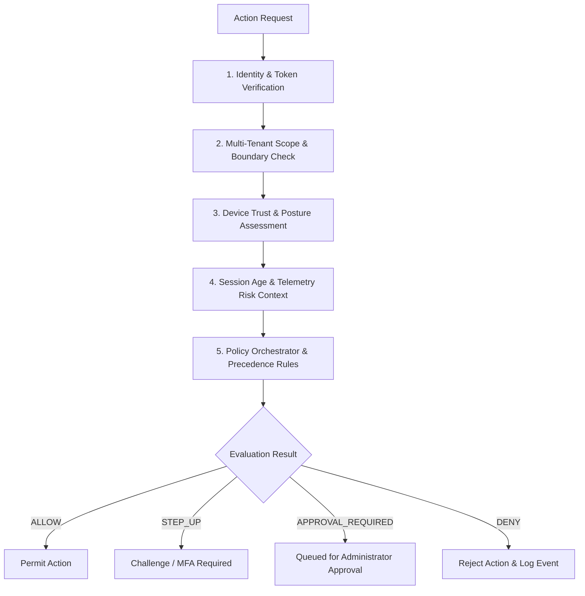

# Zero-Trust Security Architecture

## 1. Executive Summary

Phase 19 implements an enterprise **Zero-Trust Security Architecture** across the Theatre Anti-Piracy Platform. Rather than granting implicit trust based on network perimeter, user role, or session initialization, every access request is dynamically evaluated against identity credentials, tenant boundaries, device postures, telemetry signals, and active security policies.

---

## 2. Core Architectural Principles

1. **Explicit Verification**: Always authenticate and authorize based on all available data points (identity, tenant scope, device health, session age, live risk signals).
2. **Least-Privilege Access**: Limit user access with Just-In-Time (JIT) and Just-Enough-Access (JEA) policies, multi-signature approvals, and adaptive risk-based controls.
3. **Assume Breach**: Minimize blast radius, segment multi-tenant boundaries (Studios vs Theatres), encrypt end-to-end telemetry, and maintain immutable audit chains.
4. **Advisory First & Safety-Critical**: Zero-trust engines generate explainable reason codes for SOC intervention and never terminate cinema screens automatically on predictive signals alone.

---

## 3. Zero-Trust Multi-Stage Pipeline

### Stage 1: Identity & Token Verification
- Cryptographic JWT signature verification, subject claim validation, and actor role extraction (`ADMIN`, `THEATRE_ADMIN`, `PRODUCTION_COMPANY`, `THEATRE_STAFF`).

### Stage 2: Multi-Tenant Boundary Isolation
- Verifies that actors cannot traverse tenant boundaries (e.g. Theatre A cannot access Theatre B's playback devices or telemetry; Studio Universal cannot access Studio Warner's watermarking seeds or analytics).

### Stage 3: Device Trust Posture
- Evaluates SHA-256 hashed device fingerprints (`TRUSTED`, `UNKNOWN`, `SUSPICIOUS`, `BLOCKED`). Blocked devices are denied access across all zero-trust gateways.

### Stage 4: Session Age & Telemetry Risk Context
- Sessions older than 8 hours incur trust decay penalties. Correlated threat intelligence matches and real-time security events dynamically reduce the computed trust score.

### Stage 5: Policy Orchestrator & Rule Evaluation
- Matches applicable active policies in priority order (lowest priority index evaluated first) to determine final access decisions.

---

## 4. Decision Types & Explainability

Every access decision is permanently recorded in the `AccessDecision` table with:
- `decision`: `ALLOW`, `STEP_UP`, `APPROVAL_REQUIRED`, `DENY`
- `trustScore`: 0–100 deterministic score
- `riskScore`: 100 - trustScore
- `reasonCodes`: Detailed explainability string (e.g., `"AUTHENTICATED_IDENTITY, TRUSTED_DEVICE, VALID_TENANT_SCOPE"`)
- `correlationId`: End-to-end traceability identifier
